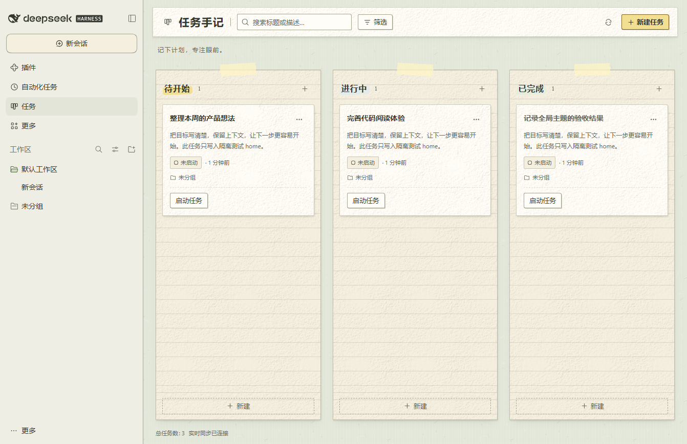
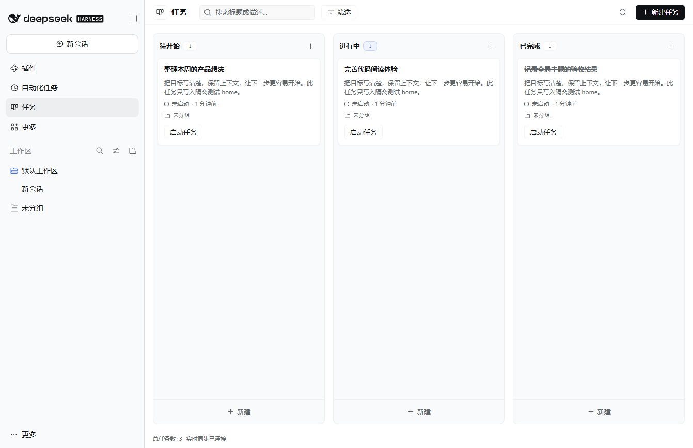
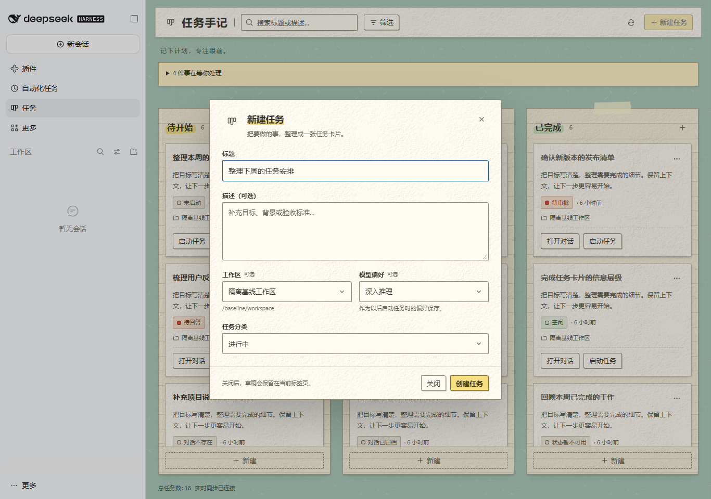
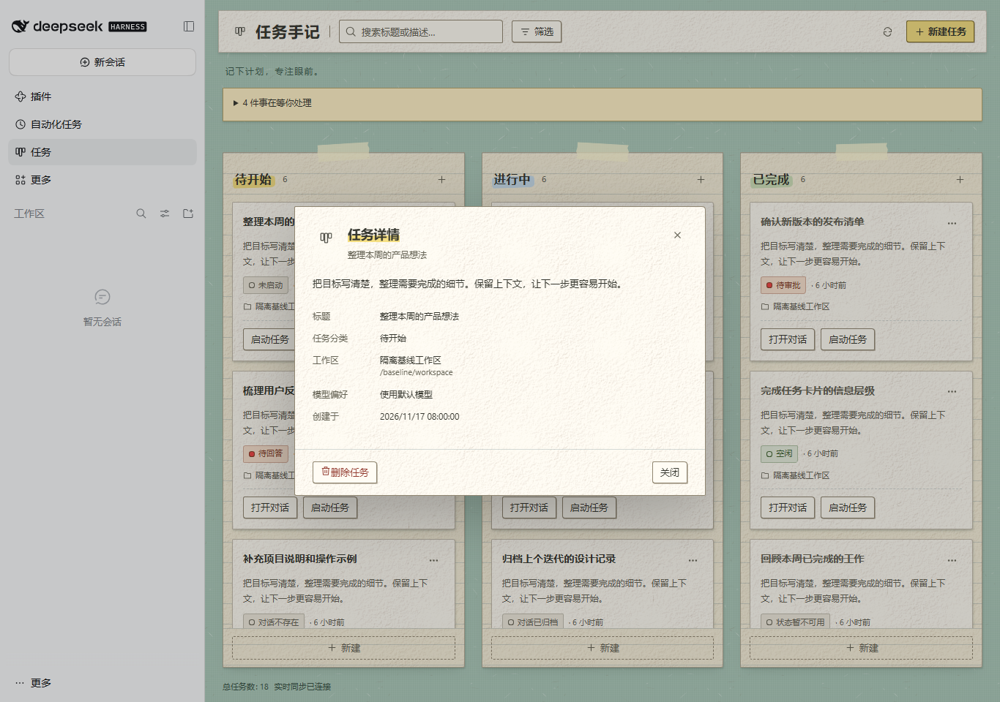
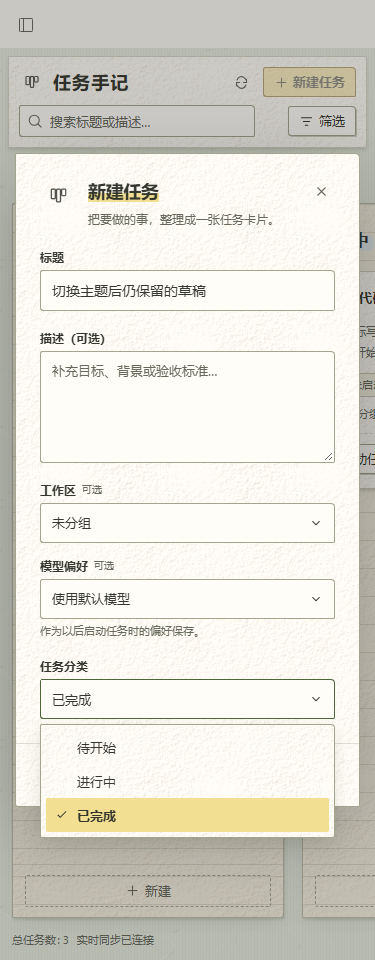

# dsh-plugin-tasks

[](package.json)
[](#安装)
[](LICENSE)

DeepSeek Harness（DSH）插件：把要做的事整理成**任务看板**，从卡片一键启动会话，并实时查看执行、审批、回答和错误状态。

插件提供 Host 任务存储与 Web 看板，支持工作区和模型偏好、任务搜索与筛选、跨页面实时同步，以及启动失败后的恢复。默认跟随 DSH 外观；可选启用独立的 `dsh-plugin-paper-theme`，使用纸纹、胶带与高亮组成的纸面主题。

## 安装

需要 Node.js 24、DSH `0.2.2-rc.1` 和可用的 pnpm。当前兼容声明固定到已验证的 DSH 版本。

从源码安装：

```bash
git clone https://github.com/Tavlo-dsh/tavlo-plugins-tasks.git
cd tavlo-plugins-tasks
npm install
dsh plugin --profile web add "$(pwd)"
```

也可在源码目录生成独立安装包，再安装到本机或复制到其他机器：

```bash
npm pack
dsh plugin --profile web add ./dsh-plugin-tasks-0.1.0.tgz
dsh --profile web
```

`web` 应替换成实际使用的 profile。安装后在侧栏打开「任务」；更新后重新加载 Host 插件并刷新浏览器。安装包包含可直接运行的 Host/Client JS，无需构建。

创建、查询、改列和实时同步不需要模型凭据；启动任务需要已配置的可用模型。干净 Web profile 首次启动时，可在继续预览说明后关闭模型登录引导。

卸载使用 `dsh plugin --profile web remove dsh-plugin-tasks`。任务数据保存在 DSH home，重新安装后可恢复已有任务。

## 运行方式

| 方面 | 行为 |
| --- | --- |
| 任务看板 | 按「待开始 / 进行中 / 已完成」分列，支持搜索标题和描述、按工作区筛选、折叠列与查看完整详情。已完成列默认显示最近更新的 10 条。 |
| 新建任务 | 只有标题必填，可保存描述、工作区、模型偏好和初始分类。创建任务本身不会启动会话。草稿和结果待确认的创建请求保存在当前标签页。 |
| 启动会话 | 从卡片打开启动面板，选择工作区、模型、智能体预设并编辑本次首条消息。成功后关联会话并打开对话，只把「待开始」自动改为「进行中」。 |
| 会话状态 | 卡片显示执行中、待审批、待回答、出错、空闲，以及会话丢失、归档或不可用。审批和回答仍在原对话中处理。 |
| 启动恢复 | 启动进度与请求标识持久化。结果未知或中途失败时，通过「恢复启动」复用同一会话和消息请求，避免重复投递。尚未投递消息时可结束本次启动。 |
| 实时同步 | 每个页面共用一条任务 SSE 连接，任务更新和删除自动同步；断线后自动重连并恢复完整快照，保留当前草稿、搜索和筛选。 |
| 删除任务 | 卡片操作菜单和详情页均提供删除入口，确认后移除任务；关联对话保留并继续运行。未结束的启动请求需先恢复或结束。 |
| 持久化 | 使用宿主 `storageDomain`，默认 JSON 后端写入 `$DSH_HOME/storages/tasks.json`。当前存储版本为 4，可读取版本 1、2、3。 |
| 外观 | 默认使用 DSH 语义颜色；启用独立纸面主题后切换装饰，支持浅色、深色与窄屏布局。任务页没有独立主题开关。 |

## 界面预览

以下为任务看板的实际界面截图。纸面效果需要另行安装并在全局设置启用 `dsh-plugin-paper-theme`；看板功能可独立使用。

**纸面主题 · 浅色看板**



| DSH 默认外观 | 纸面主题 · 深色 |
| --- | --- |
|  |  |

| 新建任务 | 任务详情 |
| --- | --- |
|  |  |

<details>
<summary>查看窄屏界面</summary>

<p align="center">
  
</p>

</details>

## 配置

在 DSH 的 cordis 配置中修改 `tavlo-tasks`：

```yaml
- id: tavlo-tasks
  name: dsh-plugin-tasks
  config:
    maxTitleLength: 200
    maxBriefLength: 20000
    maxTasks: 10000
    maxLaunchesPerTask: 1000
    statusRefreshMs: 2000
    eventBufferBytes: 33554432
    eventHeartbeatMs: 15000
```

| 字段 | 默认值 | 说明 |
| --- | --- | --- |
| `maxTitleLength` | `200` | 新任务标题的最大长度。 |
| `maxBriefLength` | `20000` | 新任务描述的最大长度。 |
| `maxTasks` | `10000` | 可保存的任务数量上限；删除回执不计入。 |
| `maxLaunchesPerTask` | `1000` | 单任务新启动历史的数量上限；已有请求仍可恢复或重放。 |
| `statusRefreshMs` | `2000` | 会话状态补充采样间隔，单位 ms，范围 500–60000；同时响应宿主事件。 |
| `eventBufferBytes` | `33554432` | 单条 SSE 连接的待发队列上限，默认 32 MiB，范围 64 KiB–256 MiB。 |
| `eventHeartbeatMs` | `15000` | SSE 心跳间隔，单位 ms，范围 1000–60000；代理需支持流式响应。 |

降低限额不会使已有任务失效，也不阻止重放已完成的创建请求。单次完整快照超过 `eventBufferBytes` 时，需要提高限额才能恢复实时流；普通 RPC 读取仍可用。

## 限制

- 选择具体模型启动任务时，会同时更新 DSH 的全局默认模型，启动面板会提示。工作区和模型引用失效时，需要重新选择可用项。
- 改列不会启动、取消或停止会话。运行、排队、等待输入或状态不可用的会话不能直接替换；删除任务也不会停止关联对话。
- 插件重新加载后不会自动发送未完成的启动请求，需要手动点击「恢复启动」。消息已进入投递阶段时，仅允许恢复，避免重复执行。
- 同一任务 JSON 文件需要由一个 Host 进程写入，未提供跨进程写入协调。升级到存储版本 4 后，不应直接降级到不支持该版本的旧插件。
- 持久化结果不确定时会暂停读写，需重新启用插件或重启 Host 后恢复。损坏记录会使插件初始化失败，不会被空列表覆盖。
- 草稿保存在当前标签页的 `sessionStorage`；关闭标签页、清除浏览器存储或禁用存储可能使草稿丢失。

## 开发

```bash
npm install
npm test
npm pack
```

Host 和浏览器半边均为直接运行的 JS，没有构建步骤。测试使用 Node 自带测试运行器和发布版 Storage/Domain/JSON 后端；当前 76 项测试覆盖持久化、并发去重、启动恢复、删除和跨页面同步。

改完 `client.js` 后刷新客户端；改完 Host 文件后重新加载插件或重启 DSH。若卸载或重启期间遇到宿主 `session-maybe` adapter 错误，可刷新页面恢复，详见 [独立安装验证](docs/step-5-verification.md)。

设计说明见 [docs/design.md](docs/design.md)。

完整操作说明、RPC 接口、源码结构及验证记录见 [docs/usage.md](docs/usage.md)。

全局主题适配见 [docs/global-theme-adaptation.md](docs/global-theme-adaptation.md)。纸张纹理内嵌于 `client.js`，来源、复制范围和 MIT 许可见 [docs/looseleaf-source-map.md](docs/looseleaf-source-map.md)。
