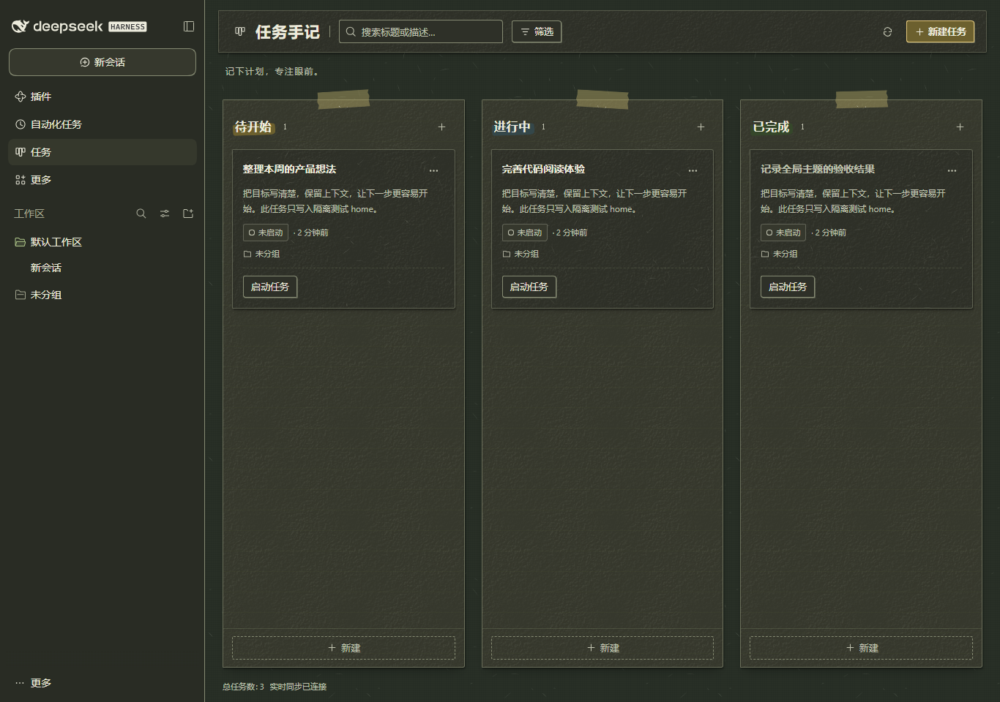
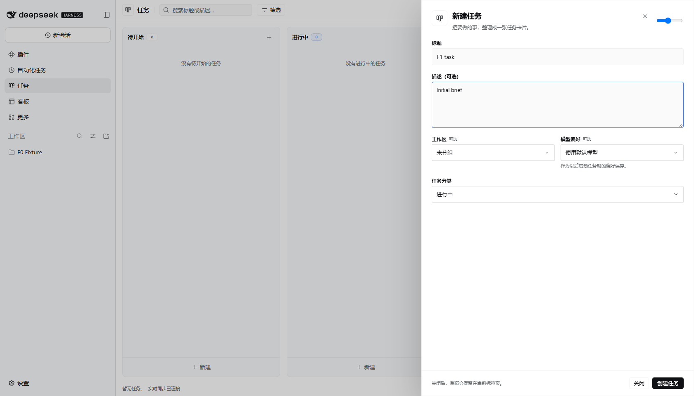
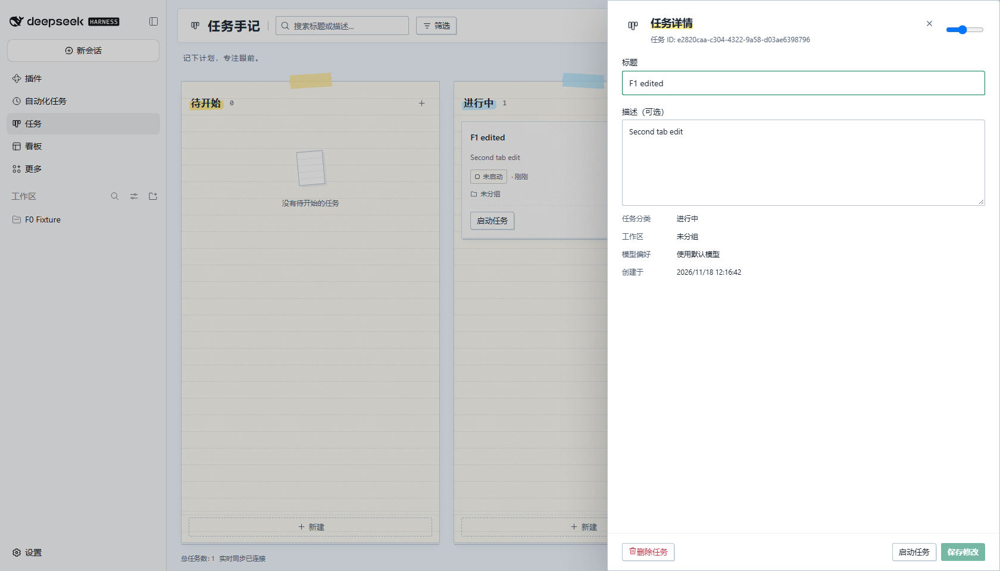
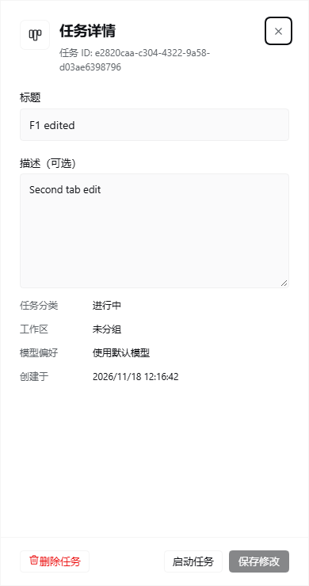

# Tavlo 任务看板（`@tavlo-dsh/dsh-plugin-tasks`）

[](package.json)
[](#安装)
[](LICENSE)

DeepSeek Harness（DSH）插件：把要做的事整理成**任务看板**，从卡片一键启动会话，并实时查看执行、审批、回答和错误状态。

插件提供 Host 通用任务服务、MCP 服务、SQLite 持久化与 Web 看板，支持工作区和模型偏好、任务搜索与筛选、跨页面实时同步，以及启动失败后的恢复。外部插件负责拉取和同步远端事项，通过 `taskService` 推送任务。默认跟随 DSH 外观；可选启用独立的 `@tavlo-dsh/dsh-plugin-paper-theme`。

## 安装

需要 Node.js 24、DSH `0.2.2-rc.1` 和可用的 pnpm。当前兼容声明固定到已验证的 DSH 版本。

在 DSH 的插件管理中按包名安装 `@tavlo-dsh/dsh-plugin-tasks`，或使用 CLI：

```bash
dsh plugin --profile web add @tavlo-dsh/dsh-plugin-tasks
```

如果此前安装过 Tavlo 的**未加 scope 的本地旧包**，先备份数据、卸载旧包，再安装新包，避免两个版本同时启用。不要从 npm 安装同名的 `dsh-plugin-tasks`，它不是本项目。

从源码安装：

```bash
git clone https://github.com/Tavlo-dsh/tavlo-plugins-tasks.git
cd tavlo-plugins-tasks
npm install
npm run build
dsh plugin --profile web add "$(pwd)"
```

也可在源码目录生成独立安装包，再安装到本机或复制到其他机器：

```bash
npm pack
dsh plugin --profile web add ./tavlo-dsh-dsh-plugin-tasks-0.2.1.tgz
dsh --profile web
```

`web` 应替换成实际使用的 profile。安装后在侧栏打开「任务」；如果更新了客户端入口路径，需重启 DSH Host，刷新页面不会让正在运行的 Host 重新解析入口。安装包包含可直接运行的 Host/Client JS，安装方无需构建。

创建、查询、改列和实时同步不需要模型凭据；启动任务需要已配置的可用模型。干净 Web profile 首次启动时，可在继续预览说明后关闭模型登录引导。

卸载使用 `dsh plugin --profile web remove @tavlo-dsh/dsh-plugin-tasks`。任务数据保存在 DSH home，重新安装后可恢复已有任务。

## 运行方式

| 方面 | 行为 |
| --- | --- |
| 任务看板 | 顶部可切换 DSH 的任一工作区，默认展示所有工作区和未分组任务。保留「待开始 / 进行中 / 已完成」三列；在「看板设置」可管理列和标签。窄屏工具栏自动换行，宽屏左侧自动显示手记概览。拖动卡面即可排序或跨列移动；触屏长按后拖动，也可使用菜单。点击列名可收窄该列。已完成列超过 10 项才显示「查看全部」，搜索不截断匹配结果。 |
| 任务抽屉 | 从右侧新建任务，只有标题必填，可选描述、工作区和模型偏好。从列中创建直接进入该列，不用再选分类。新建保留当前标签页草稿，不启动会话。点击卡片编辑标题、Markdown 描述和看板属性；冲突时不覆盖新版本。 |
| 协作与查询 | 新建任务时可输入并新建标签或优先级（预置 P0/P1/P2），用日历选择截止日期。详情可发布评论，按日回看动态或仅查看评论；看板支持按工作区、标签、优先级、到期状态筛选。 |
| 任务文件 | 在新建或详情抽屉选择、粘贴或拖入文件；可下载、移除，PNG/JPEG/WebP 可预览。每卡最多 10 个文件，单个最多 10 MiB（图片受宿主限制）。启动时仅图片可随首条消息发送，其他文件只保存在任务中。 |
| 启动会话 | 从卡片打开启动面板，选择工作区、模型、智能体预设并编辑本次首条消息。成功后关联会话并留在看板，只把「待开始」自动改为「进行中」。需要时点击「打开对话」。 |
| 会话状态 | 卡片显示执行中、待审批、待回答、出错、空闲，以及会话丢失、归档或不可用。审批和回答仍在原对话中处理。 |
| 另开对话 | 在任务卡片或任务详情的「…」菜单点「新开一个对话」。默认从空白开始；选择 Fork 可继承上一对话最近已完成轮次的历史，首条消息只发给新对话。原对话保留在任务历史中。 |
| 从对话回到任务 | 在 DSH 对话列表点击该对话的「…」→「打开关联任务」，直接打开任务详情，不改变看板筛选。当前绑定和历史对话均可跳转；未关联任何任务的对话不显示入口。 |
| 启动恢复 | 恢复启动会复用已记录的目标会话和消息请求。如果 Fork 已经发起、却无法确认子会话 ID，面板会停止，不重复创建分支或发送消息。 |
| 实时同步 | 每个页面共用一条任务 SSE 连接，任务更新和删除自动同步；断线后自动重连并恢复完整快照，保留当前草稿、搜索和筛选。 |
| 删除任务 | 卡片操作菜单和详情页均提供删除入口，确认后移除任务；关联对话保留并继续运行。未结束的启动请求需先恢复或结束。 |
| 持久化 | SQLite v8 在 `$DSH_HOME/storages/tasks.sqlite` 保存任务、动态和文件引用，附件内容使用宿主附件存储。原 v5–v7 任务和回执保留，支持 v1–v4 JSON 导入。升级前先停 Host，同时备份数据库和附件，勿用旧版直接打开升级后的库。 |
| 插件接入 | 通过 `taskService` 查询、创建、更新与订阅任务，支持通用来源标识、来源去重和持久化更新回执。TAPD 等外部系统的同步由连接器插件负责。 |
| MCP | 提供经过宿主认证的 Streamable HTTP 端点及 `dsh-tasks-mcp` stdio 桥接，复用 TaskService；创建任务不会自动启动会话。 |
| 外观 | 默认跟随 DSH；可选装 `@tavlo-dsh/dsh-plugin-paper-theme`，在看板工具栏切换「跟随全局 / iOS 圆角 / 纸面主题」。亮暗模式仍跟随 DSH。 |

## 界面预览

以下为任务看板的实际界面截图。纸面与 iOS 圆角效果需要另装 `@tavlo-dsh/dsh-plugin-paper-theme`；看板功能可独立使用。

**纸面主题 · 浅色看板**


| DSH 默认外观 | 纸面主题 · 深色 |
| --- | --- |
|  |  |

| 新建任务 | 任务详情 |
| --- | --- |
|  |  |

<details>
<summary>查看窄屏界面</summary>

<p align="center">
  
</p>

</details>

## 配置

在 DSH 的 cordis 配置中修改 `tavlo-tasks`：

```yaml
- id: tavlo-tasks
  name: '@tavlo-dsh/dsh-plugin-tasks'
  config:
    maxTitleLength: 200
    maxBriefLength: 20000
    maxTasks: 10000
    maxLaunchesPerTask: 1000
    maxUpdatesPerTask: 10000
    sqliteJournalMode: wal
    mcpEnabled: true
    mcpLocalPort: 32145
    statusRefreshMs: 2000
    eventBufferBytes: 33554432
    eventHeartbeatMs: 15000
```

| 字段 | 默认值 | 说明 |
| --- | --- | --- |
| `maxTitleLength` | `200` | 新任务标题的最大长度。 |
| `maxBriefLength` | `20000` | 新任务描述的最大长度。 |
| `maxTasks` | `10000` | 可保存的任务数量上限；删除回执不计入。 |
| `maxLaunchesPerTask` | `1000` | 单任务新启动历史的数量上限；已有请求仍可恢复或重放。 |
| `maxUpdatesPerTask` | `10000` | 单任务内容更新回执上限，包含无变化更新；不自动淘汰回执，达到上限拒绝新更新，原请求仍可重放。 |
| `databasePath` | 空字符串 | 默认 `$DSH_HOME/storages/tasks.sqlite`；可指定 SQLite 文件路径，仅由 Host 配置，不能通过 RPC 设置。更换路径前需迁移已有 SQLite 数据。 |
| `sqliteJournalMode` | `wal` | 支持 `wal`、`delete`、`truncate`、`persist`；网络文件系统按其能力选择回滚日志模式。 |
| `mcpEnabled` | `true` | 启用 DSH 内置 `tasks_*` 工具及 HTTP MCP（包括本机密钥接入）；不影响原有任务 RPC。 |
| `mcpLocalPort` | `32145` | 「MCP 接入」使用的独立本机端口，只监听 `127.0.0.1`。不要通过代理或端口转发对外暴露。 |
| `statusRefreshMs` | `2000` | 会话状态补充采样间隔，单位 ms，范围 500–60000；同时响应宿主事件。 |
| `eventBufferBytes` | `33554432` | 单条 SSE 连接的待发队列上限，默认 32 MiB，范围 64 KiB–256 MiB。 |
| `eventHeartbeatMs` | `15000` | SSE 心跳间隔，单位 ms，范围 1000–60000；代理需支持流式响应。 |

降低限额不会使已有任务失效，也不阻止重放已完成的创建和更新请求。单次完整快照超过 `eventBufferBytes` 时，需要提高限额才能恢复实时流；普通 RPC 读取仍可用。

## 外部插件与 MCP

第三方插件在 Cordis 可选依赖分支中取得 `taskService`，用 `execute('create', input)` / `execute('update', input)` 推送数据。公开 TypeScript 类型从 `@tavlo-dsh/dsh-plugin-tasks/service` 导入。服务不保存 TAPD 凭据，不主动抓取远端数据，也不把本地改列自动回写远端。

### 在 DSH 会话中（无需配置）

启用任务插件后，DSH 自动注册 `tasks_*` 内置工具，无需创建密钥，也不修改你的 MCP 配置。改完插件或升级后，先重载插件；如果外部客户端缓存了工具列表，重新连接该 MCP。已经手动添加过 `dsh_tasks` 的 DSH 用户，可以移除重复的外部配置，继续用内置工具操作同一个共享看板。

创建时可传 `labelId`、`priority` 和 `dueDate`。先用 `tasks_board` 查标签 UUID、优先级键和当前看板版本；截止日期用 `YYYY-MM-DD` 日历日期。用 `tasks_edit_labels` 新建、修改或删除标签，用 `tasks_edit_priorities` 新建、改显示名称、排序或删除优先级。仍被任务使用的选项不能删除。

### 本机外部 MCP 客户端

1. 打开 DSH 的「任务」看板，点击工具栏的「MCP 接入」→「生成密钥」。
2. 点击「复制 MCP 配置」，将 `dsh_tasks` 加入支持 Streamable HTTP 和自定义标头的 MCP 客户端。用 `tasks_list` 检查是否连接到同一看板。
3. 密钥仅在生成后显示；DSH 或 Web 端口变更不影响密钥和独立 MCP 端口。重新生成或撤销后，旧密钥不能发起新的任务操作。

本机地址默认是 `http://127.0.0.1:32145/mcp`。这把密钥只授予任务 MCP 权限（包括修改共享标签和优先级目录），不能登录 DSH、启动会话或删除任务。DSH 只保存密钥摘要；不要分享包含密钥的客户端配置，不要转发端口。

### 兼容方式：DSH owner 认证

宿主的 HTTP MCP 地址 `/api/dsh-plugin-tasks/mcp` 保留 owner、Host 和 Origin 校验。需使用旧的 stdio 接入时，安装包仍提供桥接：

```json
{
  "mcpServers": {
    "dsh_tasks": {
      "command": "node",
      "args": ["/absolute/path/to/node_modules/@tavlo-dsh/dsh-plugin-tasks/bin/tasks-mcp.js"],
      "env": {
        "DSH_TASKS_URL": "http://127.0.0.1:3000/",
        "DSH_TASKS_TOKEN": "从本次 DSH 启动 URL 的 token 参数取得"
      }
    }
  }
}
```

替换脚本路径、端口和令牌；Windows JSON 路径可使用 `/`。Host 必须运行并启用 Gateway。桥接通过 `/connect` 换取独立 API 身份，并用 WebSocket 管理其生命周期，不读取浏览器 Cookie。Host 重启后需更新启动令牌并重启桥接。令牌属于 owner 凭据，不要提交到仓库。

完整契约、连接器示例、MCP 工具和迁移恢复说明见 [通用服务与 MCP 接入](docs/task-service.md)。

## 限制

- 选择具体模型启动任务时，会同时更新 DSH 的全局默认模型，启动面板会提示。工作区和模型引用失效时，需要重新选择可用项。
- 改列不会启动、取消或停止会话。运行、排队、等待输入或状态不可用的会话不能直接替换；删除任务也不会停止关联对话。
- 插件重新加载后不会自动发送未完成的启动请求，需要手动点击「恢复启动」。消息已进入投递阶段时，仅允许恢复，避免重复执行。
- 同一任务 SQLite 文件需要由一个 Host 进程管理；Domain 维护内存快照，不支持多个 Host 同时写入同一文件。迁移后旧 JSON 仅是升级时备份，不能直接降级或把它当作最新数据。
- 持久化结果不确定时会暂停读写，需重新启用插件或重启 Host 后恢复。损坏记录会使插件初始化失败，不会被空列表覆盖。
- 草稿保存在当前标签页的 `sessionStorage`；关闭标签页、清除浏览器存储或禁用存储可能使草稿丢失。

## 开发

```bash
npm install
npm test
npm pack
```

Host 直接运行源码。`npm run build` 将拖拽依赖打入 `lib/client.js`，浏览器只向 DSH 请求它提供的模块（例如 React）；`npm test` 和 `npm pack` 都会先构建。测试使用 Node 自带测试运行器、发布版 Domain/JSON/SQLite 后端、真实认证 HTTP 和 MCP SDK 客户端，覆盖浏览器入口、存储迁移、插件接入、MCP、并发去重、启动恢复、删除和跨页面同步。验证范围见 [本次验证记录](docs/service-mcp-sqlite-verification.md)。

改完 `client.js` 后运行 `npm run build`，本地目录安装由 Web 热重载加载构建产物；用安装包部署则重新打包再安装。改完 Host 文件后重新加载插件或重启 DSH。若卸载或重启期间遇到宿主 `session-maybe` adapter 错误，可刷新页面恢复，详见 [独立安装验证](docs/step-5-verification.md)。

设计说明见 [docs/design.md](docs/design.md)。

完整操作说明、RPC 接口、源码结构及验证记录见 [docs/usage.md](docs/usage.md)。

全局主题适配见 [docs/global-theme-adaptation.md](docs/global-theme-adaptation.md)。纸张纹理内嵌于 `client.js`，来源、复制范围和 MIT 许可见 [docs/looseleaf-source-map.md](docs/looseleaf-source-map.md)。
