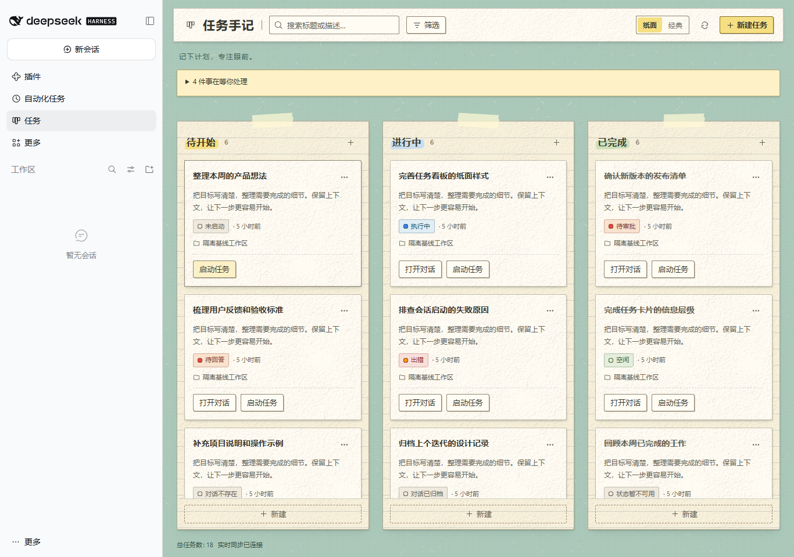

# 纸面视觉接入记录

> 本文保留首次纸面接入的历史截图与性能样本。后续已移除经典模式、新增删除及纸面选择组件，并调整焦点和遮罩；当前行为见 [任务删除与交互调整](task-controls-verification.md)。

日期：2026-11-17。阶段 1 只建立源码审查与经典外观基线，因此当时界面没有视觉变化。用户随后提供 Looseleaf 官网截图，要求明确的纸质风格；本轮已将该方向实现到真实任务 Client，默认启用。

## 实际效果



浅绿色纤维桌面承托三张带横线的奶油色纸页，列头使用半透明胶带与黄、蓝、绿荧光笔标记。卡片、工具栏和弹框使用原始纸纹，按钮采用略不规则边框与轻阴影。中文内容继续使用宿主字体。

- [深色纸面](screenshots/tasks-paper-dark.png)：暖灰纸张、深绿桌面，纹理以 soft-light 混合。
- [新建弹框](screenshots/tasks-paper-create.png)、[启动弹框](screenshots/tasks-paper-launch.png)：保留原生表单与 dialog。
- [375 px 窄屏](screenshots/tasks-paper-mobile.png)：工具栏分三行，看板内部横向滚动。

顶栏“纸面 / 经典”即时切换，使用独立的 sessionStorage 键 `dsh-plugin-tasks:appearance-v1`。默认纸面；同一标签页保留已选外观，存储禁用时仍可在内存中切换。安装本地源码的用户重新加载任务插件并刷新页面即可看到效果。

## 实现边界

改动集中在 `client.js`：局部 token、纹理、`PaperFrame / TaskButton / StatusBadge`、外观偏好和 dialog 的 Tab 首尾循环。仅改变任务面板内的样式；Host、RPC、任务 schema、持久化及启动协议未改动。

纹理取自固定提交 `4bdb647940e2fefb3cebb394f3bad25c766a27d2` 的 `PAPER_SLIP.uri` 与 `PAPER_FIBRE.uri`，原 PNG 字节不变。另摘取 `rng.ts` 中的哈希函数，以任务 ID 与组件角色生成稳定背景偏移。复制范围、哈希及 MIT 署名见 [源码映射](looseleaf-source-map.md) 与 [锁文件](looseleaf-source-lock.json)。

所有纹理内嵌，没有新增 CDN、字体、npm 运行依赖或构建步骤；仍使用宿主 React 18。没有增加每卡片 observer、动画循环或缓存。

## 自动化与浏览器检查

`npm test`：**68 项通过，0 失败**。原有 64 项回归继续通过，新增覆盖外观默认值、存储不可用、无效值、销毁后禁止发布、创建期间保持原表单与重试 ID、装饰 seed 稳定；原启动响应丢失用例补充了外观切换不改变恢复请求的断言。

隔离临时 DSH home 使用真实 ModuleLoader、React 与浏览器渲染器，任务 RPC/SSE 使用固定内存样本，禁止任务写操作。检查包括：

- 实际点击外观按钮及验证 sessionStorage。
- 弹框保持同一 DOM、输入元素、焦点、输入值及 `[2, 6]` 选区。
- 连续 16 次 Tab 保留在弹框内，Esc 关闭后恢复打开按钮焦点。
- 启动说明在外观切换后保留；卡片菜单 Enter 打开、Esc 关闭并恢复焦点。
- 1366 / 1024 / 768 / 375 px 下任务根节点不溢出，工具栏控件不重叠，弹框不超出视口且底部关闭按钮可达。窄屏的三列在看板内部横向滚动。
- 强制色彩下保留边框和焦点；减少动态效果模式下禁用过渡。
- 外观、弹框和样本切换全过程只创建 1 条任务 SSE。

最终实测数据、环境、源文件哈希、错误数组及保护文件哈希见 [机器可读报告](looseleaf-paper-baseline.json)。最终运行无页面异常、控制台错误或任务写请求；检查前后现有 home 的任务 JSON、Web package、cordis 与 cordis patch 四个文件哈希均一致。较早一次试跑检测到现有 home 的 cordis patch 哈希变化并按设计报错，哈希本身不能确认写入者；本轮没有覆盖或回滚该文件，最终复测使用其当时的最新哈希。

## 包体与性能

客户端（包含 JS、内嵌 CSS 与纹理）从 85,050 字节增加至 134,350 字节；gzip level 9 从 20,786 增至 50,677 字节，增加 **29,891 字节（29.19 KiB）**，低于 30 KiB 增量预算。原始纹理 PNG 共 23,847 字节。

环境：Windows 11、i7-12700H、Node 24.18.1、DSH 0.2.2-rc.1、宿主 React 18.3.1、Edge 157.0.4341.60、Playwright 1.65.1，1366×960、DPR 1、headless，无 CPU 限速。

每个主题及数量先预热 1 次，再测 5 次取中位数。经典与纸面在同一 profile、每一轮成对测试并交替先后顺序，减少先测全部经典再测全部纸面产生的时间偏差。全部 100/500 张卡片均已挂载，完成列展开。搜索从原生 input 事件开始，到仅剩 10% 命中；更新为 20 个逐一等待 DOM 提交的 SSE 状态事件。

下表单位为毫秒，单元格为 **经典 → 纸面（变化）**；DOM 时间包含强制布局：

| 主题 / 卡片数 | 挂载 | 搜索 | 连续 20 次更新合计 |
| --- | ---: | ---: | ---: |
| 浅色 / 100 | 33.8 → 35.3（+4.4%） | 11.2 → 11.3（+0.9%） | 124.2 → 115.8（−6.8%） |
| 浅色 / 500 | 241.9 → 244.8（+1.2%） | 49.1 → 53.6（+9.2%） | 832.6 → 787.0（−5.5%） |
| 深色 / 100 | 78.7 → 77.1（−2.0%） | 21.6 → 22.8（+5.6%） | 242.6 → 263.4（+8.6%） |
| 深色 / 500 | 275.0 → 210.1（−23.6%） | 59.6 → 73.4（+23.2%） | 954.1 → 615.1（−35.5%） |

**渲染预算尚未全通过**：深色 500 卡搜索增加 23.2%，超过 15% 目标。两次 requestAnimationFrame 的呈现代理指标也有超标，例如深色 500 卡搜索为 101.7 → 159.2 ms（+56.5%）；它包含帧等待，不能当作 GPU 绘制耗时。浅色 100 卡挂载代理增加 17.8%，深色 100 卡搜索代理增加 33.6%。

早一轮顺序采样曾出现相同经典外观在不同批次相差超过两倍的波动；成对采样仍不是受控性能实验，负增幅也不能解释为纸面优化了业务渲染。保留所有原始样本，后续性能验收应在稳定负载下定位深色搜索并减少重绘成本，不能宣称整体满足 15% 预算。本轮未为降低数字而隐藏卡片或改为只统计可视区域。

## 分发核验

`npm pack --json` 生成 `dsh-plugin-tasks-0.1.0.tgz`，包内容已核对包含 Client、MIT 许可、来源清单、核验脚本、实测 JSON 与五张新截图。纹理已经内嵌，不依赖单独资源文件；包中没有测试 home、认证日志或 node_modules。该检查确认发布内容完整，独立 tarball 启动与真实业务验收仍列在下一节范围中。

## 复现

开发机需另外安装 DSH `0.2.2-rc.1`、Playwright 及 Chromium/Edge；它们不是新增插件运行依赖。

```powershell
$env:DSH_CLI = '<DSH lib/bin.js 绝对路径>'
$env:PLAYWRIGHT_MODULE = '<playwright/index.mjs 绝对路径>'
$env:BROWSER_EXE = '<浏览器 exe 绝对路径>'
$env:BASELINE_OUTPUT = '<证据输出目录绝对路径>'
$env:BASELINE_APPEARANCES = 'classic,paper'
$env:BASELINE_VISUAL = '1'
# 可选：只哈希检查正在使用的 home，不在其中安装或运行测试宿主。
$env:BASELINE_PROTECTED_HOME = '<现有 DSH home 绝对路径>'
node scripts/looseleaf-baseline.mjs
```

`BASELINE_PREVIEW_ONLY=1` 跳过性能采样，仅生成截图并做视觉交互检查。脚本始终创建独立临时 home，退出时关闭测试浏览器和测试 Host。临时宿主日志可能含认证信息，不纳入包或文档。

离线来源核验：`node scripts/looseleaf-audit.mjs <固定提交的源码缓存目录>`；校验 60 个文件、完整 MIT 原文及两个内嵌 PNG 哈希。

## 验收范围

本轮完成了实际纸面界面和上述检查，不等同于计划阶段 5 的全部验收。本轮浏览器样本不发送真实创建、改列或启动请求，完整真实业务流程、双页写入、200% 缩放、量化对比度及独立 tarball 运行仍需后续专项验收。已有业务回归由 68 项自动化测试覆盖。
