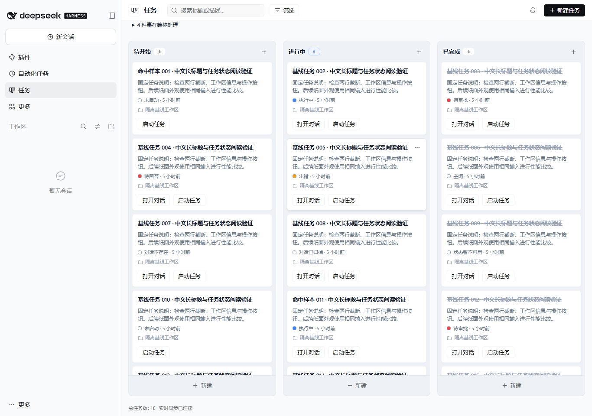
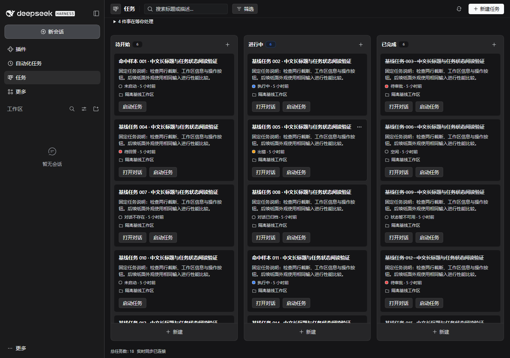

# Looseleaf 阶段 1：源码审查与经典外观基线

此文为接入前的历史基线；已实施的纸面外观见 [当前接入记录](looseleaf-paper-verification.md)。下文“当前”均指阶段 1 采集时点。

完成日期：2026-11-17。阶段 1 的上游范围、许可、亮暗截图、客户端大小和 100/500 卡片性能基线均已留存，可以进入阶段 2。当前运行界面仍是经典外观；`PaperFrame`、`TaskButton`、`StatusBadge` 与外观切换尚未实现。

## 源码与分发

上游固定为 `4bdb647940e2fefb3cebb394f3bad25c766a27d2`。已核对三个入口的源码依赖、registry 的递归关系及许可证，60 个文件通过 SHA-256 与 Git blob 校验。详见 [源码映射](looseleaf-source-map.md) 和 [锁文件](looseleaf-source-lock.json)。完整 MIT 原文保存在 `licenses/looseleaf-MIT.txt`。

阶段 2 限定摘取 `rng.ts` 的稳定随机函数和 `geom.ts` 的 `roundRectPoly / pillPoly`，其余视觉使用本地 CSS/SVG 适配。直接照搬组件会带入 React 19 写法、Tailwind、Radix/CVA、纹理与字体注入，故不采用。选定函数摘取后没有外部运行依赖，不要求第二份 React、CDN、字体或编译工具。

本次未修改 `client.js`、Host 模块或依赖版本。`package.json.files` 加入许可证、审查/基线 JSON 与两个开发复核脚本；脚本不会在插件加载或安装时执行。`npm pack` 已核对这些文件和截图都在包内，无 node_modules、隔离 home 或鉴权日志。

## 环境与固定样本

| 项目 | 实测值 |
| --- | --- |
| 系统 / CPU | Windows 11（10.0.26200，x64）/ Intel Core i7-12700H |
| Node / DSH | v24.18.1 / 0.2.2-rc.1 |
| 浏览器 / 驱动 | 无头 Edge 157.0.4341.60 / Playwright 1.65.1 |
| React | 宿主实际加载 18.3.1，共享原实例 |
| 视口 | 1366 × 960 CSS px，DPR 1，无 CPU 降速 |
| 隔离 | 独立临时 DSH_HOME、web profile、浏览器 context；不配置外部模型 |
| 任务样本 | 固定 ID、中文标题、两行说明、工作区、三列分类与九种显示状态；搜索命中 10% |
| 数量 | 100 / 500；完成列展开全部，断言实际 article 数量等于样本数 |
| 主题 | 同一 profile 和页面分别设置宿主 `color-scheme` 与 `body[data-ds-dark-theme]` |
| 采样 | 每个主题和数量预热一整轮，随后测量 5 轮取中位数 |

使用真实 DSH ModuleLoader、slot renderer、宿主 React、任务数据源与组件。浏览器只把任务 list/options RPC 和任务 SSE 替换为可重复的内存传输；初始任务流持续保持打开，状态事件经过真实 SSE 解码与 `receiveEvent`。不调用模型，不创建或持久化任务。

开发脚本对浏览器收到的模块包作一处测量注入，暴露 slot 原有数据源回调和 React 版本；注入前验证包中含逐字节一致的 `client.js`。磁盘上的运行源码不变。该测量是客户端交互基线，**不包含 Host 网络延迟、存储、模型或真实会话吞吐量**。

## 文件大小

压缩方法：Node `gzipSync`，level 9；字节数按 UTF-8 原文件计算。

| 内容 | 原始字节 | gzip 字节 | gzip KiB |
| --- | ---: | ---: | ---: |
| `client.js`（已包含 CSS） | 85,050 | 20,786 | 20.30 |
| 其中内嵌 CSS 单独压缩 | 12,488 | 2,631 | 2.57 |

CSS 是第一行的子集，不能把两行相加。客户端 SHA-256 为 `aabd29b13e04a0c97cc3ae8121295189a94a19612d2de295c2d72afc23b9c6b7`，与 M3 留存的运行源码相同。阶段 1 新增运行时 JS/CSS 为 **0 字节**。后续 30 KiB 预算应以新增运行资源的 gzip 差额计算，不能把开发脚本、文档和截图当成浏览器负载。

## 性能结果

单位为毫秒。以下为动作发起至目标 DOM 状态且完成同步布局的中位数（`domMs`）；20 次更新列是每轮 20 个事件耗时之和的中位数。

| 主题 | 实际卡片数 | 卡片挂载 | 搜索到 10% 结果 | 连续 20 次状态更新 |
| --- | ---: | ---: | ---: | ---: |
| 亮色 | 100 | 123.1 | 32.6 | 183.7 |
| 亮色 | 500 | 223.5 | 44.4 | 493.0 |
| 深色 | 100 | 59.3 | 22.5 | 106.3 |
| 深色 | 500 | 196.3 | 44.0 | 427.7 |

测量边界：

1. **挂载**：先通过实际数据源刷新为空列表，确认卡片数为零；随后真实 `refresh()` 消费内存 RPC，把全部卡片挂载进已存在的看板。包含返回数据解析与组件更新，不包含 DSH 冷启动、脚本下载或整个应用首次挂载。
2. **搜索**：向真实搜索框发出原生 input 事件；从事件开始到 100→10 或 500→50 张卡片，保留当前搜索逻辑和排序。
3. **状态更新**：发出 20 个递增 sequence 的 SSE status 帧，逐个等待对应卡片文字状态更新以及两个 requestAnimationFrame，避免 React 将整批合并为一次工作。交替运行/空闲，确保每帧实际改变 DOM。
4. 同时保存 `frameMs`：DOM 达到目标后再经过两个 requestAnimationFrame 的时间代理。它不是 GPU paint 或精确屏幕呈现时间。20 帧的总时长分别约为 682.9 / 710.1 / 663.5 / 663.7 ms，包含人为等待帧的时间，不能解释成 CPU 渲染耗时。

[原始测量 JSON](looseleaf-baseline.json) 保存全部 5 次样本、逐事件耗时、中位数、环境、fixture 与测量脚本哈希。采集时间为 2026-11-17 13:07（Asia/Shanghai）。亮暗结果受当时系统负载和 JIT 状态影响，不据此认定主题本身造成差异。阶段 2/3 比较应在同一机器、同一隔离 profile、同轮重新测量经典和纸面，以相同字段计算 `(paper / classic - 1) × 100%`，再判断 15% 预算。

## 截图

使用 18 张固定样本，前三行覆盖未启动、运行、审批、回答、错误、空闲、丢失、归档、未知状态。截图均已检查，无登录引导或其他弹窗遮挡。





这是阶段 1 的现状记录。窄屏、200% 缩放、对比度达标、强制色彩与完整键盘/弹框检查仍按后续阶段验收，不能从这两张截图推断已通过。

## 复现

在插件目录中运行源码审查，不需要额外 npm 包：

```powershell
node scripts/looseleaf-audit.mjs <锁定提交的上游目录>
# 省略目录时，按锁文件从固定提交下载校验，不读取线上 registry。
```

测量使用外部开发工具，不将 Playwright 或浏览器添加为插件依赖：

```powershell
$env:DSH_CLI = 'C:/path/to/@deepseek-ai/dsh/lib/bin.js'
$env:PLAYWRIGHT_MODULE = 'C:/path/to/playwright/index.mjs'
$env:BROWSER_EXE = 'C:/Program Files (x86)/Microsoft/Edge/Application/msedge.exe'
$env:BASELINE_OUTPUT = 'C:/path/to/new-baseline-output'
# 可选：以哈希确认既有正式环境文件未被本轮改写。
$env:BASELINE_PROTECTED_HOME = 'C:/Users/you/.dsh'
node scripts/looseleaf-baseline.mjs
```

脚本安装独立临时 web profile、配置离线默认模型、启动 Host 与无头浏览器，关闭宿主延迟出现的登录引导，再执行采样并在 finally 中停止浏览器和 Host。输出只有 `baseline.json` 和两张 PNG。临时 home 与包含登录地址的日志留在系统临时目录，不复制进文档或发布包。

## 验证摘要与进入下一阶段条件

- `npm test`：**64 项通过，0 失败**，保留现有业务回归。
- `node scripts/looseleaf-audit.mjs <已下载快照>`：60 个固定文件与完整 MIT 许可全部匹配。
- 两个开发脚本通过 `node --check`；基线脚本完整运行并保存 4 组 × 5 轮结果。
- 浏览器 `pageerror`、console error、任务写操作均为 0；测量传输全程最大活跃任务流为 1。这里不替代 M3 对真实服务端 SSE 的验收。
- 正式任务 JSON 和正式 web profile 的 `package.json / cordis.yml / cordis.patch.yml` 前后 SHA-256 相同；测试 Host 与浏览器已停止。
- `npm pack` 已核对许可、两个 JSON、脚本和截图均被包含；运行依赖与安装方式保持零构建。

阶段 1 进入条件已满足：后续复制符号与依赖已明确、上游提交和许可已固定、经典基线可复现，且无需第二份 React、运行时 CDN 或编译步骤。阶段 2 从隔离预览中的三组件与外观切换开始。
