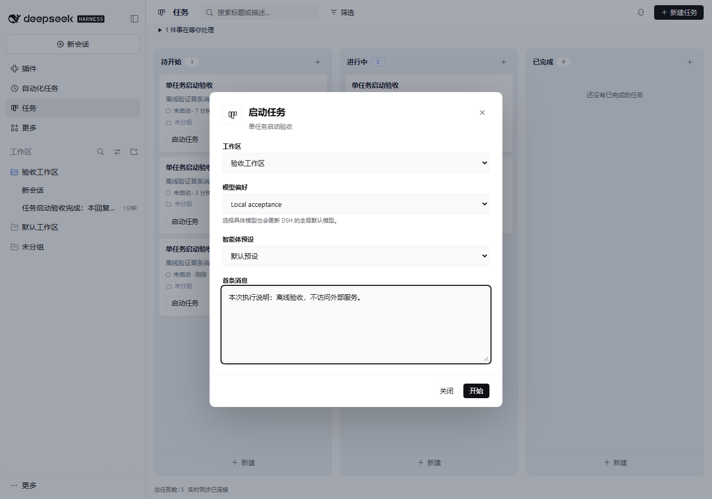
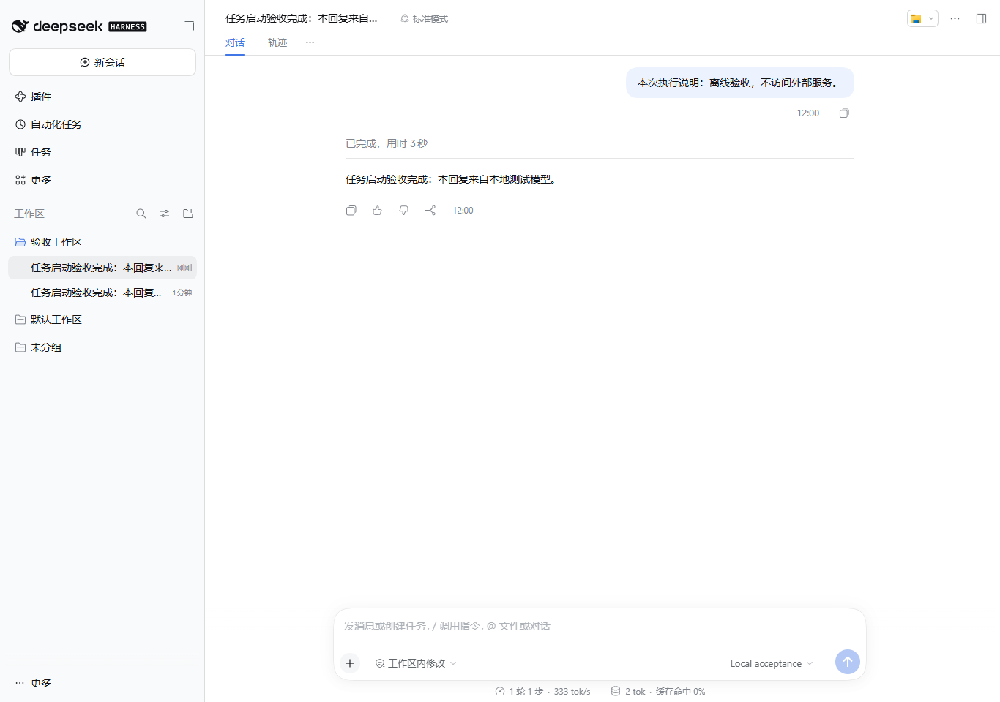

# M3：单任务启动与会话状态验证

验证日期：2026-11-17。运行环境为 Windows、Node.js 24.18.1、已发布的 DSH 0.2.2-rc.1 和无头 Edge。插件保持手写 JS、零构建，没有改动 DSH 核心。

## 本次交付

启动面板支持工作区、模型、推理强度和智能体预设，首条消息预填标题与描述，可一次性修改。显式模型选择会更新 DSH 的全局默认模型，面板已提示。成功后绑定活跃会话、将 `todo` 改为 `doing` 并打开对话；其他分类不变。已有空闲会话默认继续打开，明确选择新会话后才替换并保留历史。

Host 先保存启动请求与会话 ID，然后依次创建、选择模型、投递、绑定。每个外部操作之间记录进度。恢复不会再次创建已有会话，投递复用原 DSH 请求 ID。`prepared / created` 可结束并保留历史；`sending` 只允许恢复，因为消息可能已接收。Host 重启不会自行发送未完成请求。

新增 `activeSessionId`、`previousSessionIds`、公开的当前 `launch` 和 Host 私有的 `_launches` 去重历史。Storage Domain 升为 version 3，兼容 version 1、2，旧任务及创建请求标识保留。派生状态不落库，复用已有任务 SSE。

## 自动测试

`node --test tests/*.test.mjs`：**64 项通过，0 失败**。新增测试使用已发布的 Storage Domain 和 JSON 后端，验证：

- 多次并发启动同一请求只建一个会话、接收一条消息；不同输入复用同一标识被拒绝。
- 已有运行、排队或待输入会话不能替换；空闲时显式新建保留旧引用，完成列不被强制移回进行中。
- 模型选择失败后保留会话；关闭并重新打开 Domain 后可恢复。
- 会话创建成功、进度写入失败时重试不重建会话。
- 消息接收成功、绑定写入失败时重试仍只有一次消息接收。
- 绑定提交结果不确定时，后续启动和恢复请求持续返回隔离状态；重新打开 Domain 后从已落盘进度恢复，不重复创建或投递。
- 未投递的启动可结束并保留历史；旧请求不会重新发送；投递阶段拒绝结束。
- Client 丢失启动响应并重新加载后，复用原请求并打开同一会话。
- 无会话事件的 pending-input 变化也被采样，优先显示审批与回答；覆盖运行、空闲、错误、归档、丢失和观察器卸载。
- version 1、2 记录可读，旧创建请求继续去重；原有鉴权、并发、存储失败、SSE 与 Client 生命周期测试均通过。

## 真实 Web 与 Session 验收

在临时 `DSH_HOME` 中通过官方 `dsh plugin --profile web add` 安装插件，启动两个真实页面。实际调用发布版 `sessionController.create / selectModel / prompt / state`、`sessionQuery.observeSession` 和 Client `uiWorkspace.openSession`。

| 路径 | 结果 |
| --- | --- |
| 未配置可用模型时启动 | 会话创建、消息接收与关联成功，真实 turn 失败派生为“出错”，告警条出现 |
| 启动面板一次性改消息 | 对话收到修改后的内容；任务原描述保持不变 |
| 选择隔离工作区和本地测试模型 | 创建会话的 cwd 与选择一致；日志包含真实 `model/selection` |
| 本地模型完成一轮回复 | 第二页先显示“执行中”，再显示“空闲”；会话页展示实际回复 |
| 重放已完成启动请求 | 返回同一个会话；会话日志只有一个 `turn/start` 和一个原始任务消息 ID |
| Host 重启 | 任务 JSON 完全一致；会话关联和派生状态恢复 |
| 浏览器错误 | 两轮完整验收均无 `pageerror` |

本地测试模型是仅安装在验收环境的 DSH LLM adapter，延迟后返回固定文字，不请求外部模型、不执行工具。它不包含在插件发布包中。待审批、待回答、归档和会话缺失由接口测试覆盖，本轮真实浏览器没有触发人工审批或问答流程；付费模型供应商的网络链路不在本次范围。

启动面板：

真实会话完成回复：

## 发布与数据保护

发布文件清单已加入 `task-sessions.js`，保留全部运行时依赖和 `0.2.2-rc.1` 兼容约束。独立 tarball、测试结果与浏览器验收摘要保存在工作区 `.refs/verification/tasks-launch-20261117/`。未把测试模型、临时 DSH home 或鉴权日志打进包。

正式 `C:/Users/1/.dsh/storages/tasks.json` 以及正式 Web profile 的 `package.json`、`cordis.yml`、`cordis.patch.yml` 与步骤 5 留存的 SHA-256 相同。测试 Host 与浏览器均已停止。源码仍由正式 profile 的既有本地 link 指向，重新加载 Host 插件并刷新页面后可使用新功能；本次未替换正式 profile 配置。

## 实现范围

列切换仍为手工菜单操作。拖拽、完整详情编辑、子任务、任务取消、批量启动和 Schedule 关联留在后续阶段。JSON 后端仍要求同一任务文件由一个 Host 写入。升级后写入 version 3 数据不支持直接降回只识别旧字段的插件。
