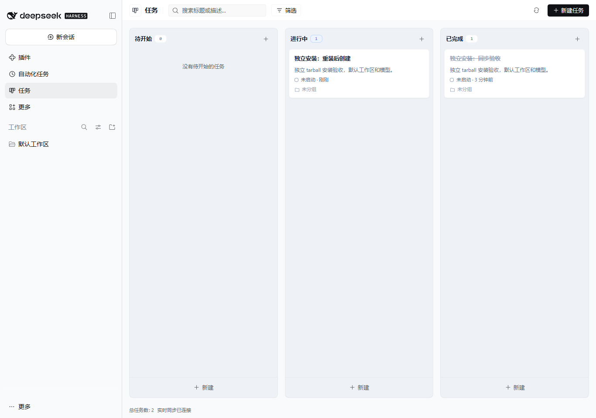

# 步骤 5：干净 Web profile 的独立安装验收

2026-11-17，Windows、Node.js 24.18.1、pnpm 11.21.0、DSH 0.2.2-rc.1。独立 tarball 安装、移除与重装、本地 link 开发路径均通过。测试使用临时 DSH home，没有复制正式 profile、模型凭据或工作区配置。

## 安装修复

首次纯生产依赖安装暴露了依赖遗漏：DSH 创建的 profile 使用 `nodeLinker: hoisted` 和 `autoInstallPeers: false`，原包没有提供 `@deepseek-ai/dsh-client-connection` 所需的 `@deepseek-ai/cordis` 与 `@deepseek-ai/dsh-scope`。`pnpm peers check` 报缺失，关闭全局搜索后直接导入 Host 模块也因找不到 Cordis 失败。

将 Cordis `~4.1.0` 从开发依赖移到运行时依赖，并新增 Scope `0.2.2-rc.1`。修正后的 tarball 在另一份全新 home 中安装成功，未安装开发依赖，peer 检查无问题。没有新增构建脚本；所有插件 JS 均直接运行。DSH 兼容声明从宽版本范围收窄到实际验证的 `0.2.2-rc.1`。

## 隔离与依赖

通过 `DSH_HOME=<临时目录>` 执行标准 `dsh plugin --profile web add --prod <tarball>`，由 CLI 创建默认 Web profile。初始依赖清单仅有任务插件；官方 base/Web 组合包按 DSH 的正常机制由已安装的 CLI 提供。

测试清除 `NODE_PATH`，使用 `node --no-global-search-paths` 启动 CLI 和直接导入检查。任务插件、Cordis、Connection、Scope、Schemastery 和 Zod 均解析到临时 profile 自己的 `node_modules`，未从源码 checkout 或作者的开发目录解析运行依赖。安装包中的全部 Host/Client JS、bundle patch 与包清单和待发布源码逐一哈希比对一致。

## 页面验收

无窗口 Edge 打开两个真实 DSH 页面，正常确认预览说明并关闭模型登录引导。干净目录没有已配置模型，Host 返回空模型目录，仍能创建不绑定工作区和模型的任务。

| 场景 | 结果 |
| --- | --- |
| 新安装 | 侧栏出现任务入口，首次列表为空，实时流已连接 |
| 新建与查询 | 表单创建真实记录，描述保存；另一页自动出现同一 ID 的卡片 |
| 改列 | 待开始 → 进行中 → 已完成，版本由 1 递增至 3，另一页自动同步 |
| 草稿与搜索 | 接收外部改列时，未提交草稿和搜索条件保留 |
| 连接数 | 正常运行时每页仅一条任务流，与卡片数无关 |
| 断线 | 主动取消一页的 Fetch 流，显示断开提示，自动重连后恢复当前分类 |
| 页面刷新 | 重新加载后读取完整任务，ID、分类和版本一致 |
| Host 重启 | 使用同一端口和存储启动新进程，两个既有页面自动恢复，完整任务文件逐字一致 |
| 卸载 | 使用 DSH CLI 移除包并启动 profile；侧栏任务入口消失，RPC 与 SSE 均返回 404，任务文件保留 |
| 重装 | 同一 tarball 重新安装，原任务完整恢复；新建与双向改列继续自动同步 |
| 本地 link | 隔离 profile 改为指向源码目录的 `link:`；两条已有任务完整恢复，卡片与实时流正常 |

重装阶段及本地 link 阶段均无浏览器 `pageerror`。此前移除插件、切回基础会话页并停止测试 Host 的过程中，记录到一次 `scope 'session-maybe' rendered without an installed adapter`。错误文本来自 DSH `packages/client/ui-renderer/src/client/bindings.tsx` 的 slot 装配检查；未据此修改宿主。重新加载和重装后的任务验收未复现，任务数据与同步均恢复。该记录保留为宿主生命周期方面的已知观察。

## 检查与交付

- `npm test`：55 项通过。
- 纯生产依赖直接导入：通过；`pnpm peers check`：无问题。
- tarball 真实页面、重启、卸载重装与本地 link：通过。
- README 已补充独立安装、运行依赖、版本限制、首次启动引导、卸载保留数据与故障处理。
- 正式 `web` profile 的清单与配置、正式任务文件在测试前后 SHA-256 一致；本次测试进程和浏览器已结束。

验收覆盖已有 `list / create / set-stage / options` 和任务实时流。删除任务、单任务启动、会话关联、执行状态、审批告警和反向代理部署不在本步骤交付范围。下一阶段按产品设计接入单任务启动与真实会话状态。
