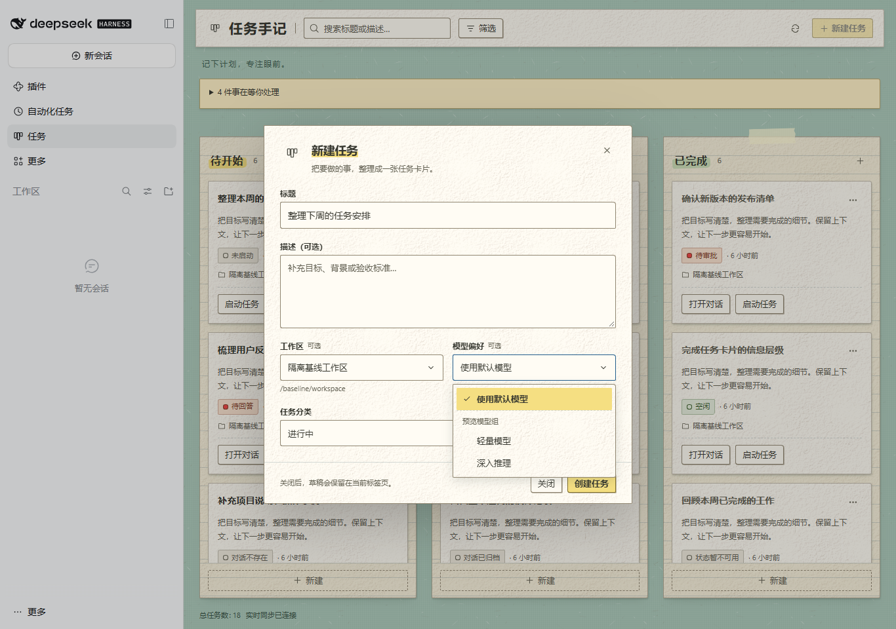

# 任务删除与纸面交互调整

> 后续全局主题适配已完成：当前默认跟随 DSH，仅在独立纸面主题开启时显示装饰。本文的“仅纸面外观”与截图描述为本次历史验证状态；当前行为见 [全局主题适配](global-theme-adaptation.md)。

日期：2026-11-17。对应用户提出的七项修改，当前代码已实现，经典模式已移除。此次包含 Host 删除接口，需要重新加载任务插件并刷新浏览器。

## 实际界面

- **删除任务**：卡片操作菜单和详情页均有入口，使用纸面确认弹框，取消时不发送删除请求。确认后同步移除卡片，关联对话保留，正在执行的对话继续运行。
- **弹框遮罩**：绿色遮罩改为 `rgba(24, 23, 21, 0.22)` 的中性灰，适用于详情、新建、启动和删除。
- **输入焦点**：新建、启动和搜索的输入控件去掉外侧 outline/box-shadow，聚焦仅改变现有边框颜色。按钮保留键盘焦点标识。
- **纸面选择列表**：替换工作区、模型、分类、推理强度、预设与筛选的全部原生 select。列表使用纸张底色、纹理、荧光笔高亮和勾选标记；模型分组保留。支持方向键、Home/End、Enter、文字前缀选择，Esc 先关闭列表。
- **失焦关闭**：卡片菜单、筛选菜单与选择列表在点击外部、焦点离开、窗口失焦或 Esc 时关闭；选择浮层使用浏览器 popover 顶层避免被弹框滚动区域裁切，外部滚动/窗口尺寸变化时收起。
- **仅纸面外观**：删除经典按钮、外观状态与偏好读写；旧标签页中保存的经典值不再影响界面。

[任务详情](screenshots/tasks-controls-detail.png) · [新建弹框](screenshots/tasks-controls-create.png) · [删除确认](screenshots/tasks-controls-delete.png) · [深色选择列表](screenshots/tasks-controls-select-dark.png) · [375 px 窄屏](screenshots/tasks-controls-mobile.png)

## 删除与同步

新增 `delete({ taskId, expectedRevision })` RPC。删除与创建、改列、启动共用持久化操作队列，版本不一致时拒绝。删除尚处于 prepared/created/sending 的启动请求会提示先恢复或结束，保留其恢复入口。

存储 domain 升级为 **version 4**，兼容读取 version 1/2/3。删除使用一次持久化写入将完整任务替换为最小回执，仅含任务 ID、创建请求 ID、删除版本和时间；任务标题、描述、绑定和启动历史均被移除。重复删除返回相同结果，重试旧创建请求会返回 `tasks/deleted`，不会重建卡片。回执不计入任务数量上限。旧版插件不支持 version 4，不能直接降级。

提交成功后发送 `remove` SSE 事件并停止追踪对应任务状态。RPC 成功响应携带 streamId/sequence，用于处理 RPC 与 SSE 到达顺序；客户端不会用迟到的修改响应复活已删除卡片。同一 Host 断线重连的完整快照能移除离线期间删除的任务。等待 SSE 的 RPC 提交缓冲上限为 1024 项，达到上限会重新连接读取快照，卸载时清空。

已确认持久化失败保留任务，结果不确定则沿用存储隔离机制，重启后依据实际磁盘状态恢复。删除确认弹框提交中禁用重复操作；丢失响应可重试同一个任务 ID 和版本。

## 验证结果

`npm test`：**76 项通过，0 失败**。包含实际发布版 Storage/Domain/JSON、Connection 与真实 HTTP 的测试，覆盖：

- 删除落盘与重启、重复删除、创建旧请求重放、任务容量释放。
- 非法参数、版本冲突、与改列竞争、持久化拒绝与未知提交恢复。
- version 1/2/3 记录兼容；未结束启动不能删除，关联会话不被删除接口操作。
- 双 Client 删除同步、关闭已删除任务详情、保留其他草稿。
- 同 Host 离线删除后的重连、迟到修改响应、旧快照均不复活卡片。
- 删除中重复点击、响应丢失重试、卸载后忽略迟到响应。

浏览器使用隔离临时 DSH home 与真实 Web 渲染器；界面操作通过固定 RPC/SSE 样本验证，删除只作用于内存样本。真实持久化和双 Client 同步由上述 HTTP 测试覆盖。浏览器检查通过：

| 检查 | 结果 |
| --- | --- |
| 经典入口与原生 select | 均为 0 |
| 输入框 / 搜索框 outline | `none` |
| 鼠标选择、分组、键盘选择 | 通过 |
| 点击外部、Tab 离开、Esc 关闭 | 通过 |
| 弹框内连续 16 次 Tab、关闭恢复焦点 | 通过 |
| 启动模型 / 推理强度 / 预设选择 | 通过 |
| 详情删除入口、取消、卡片菜单确认删除 | 通过；仅 1 次样本删除 |
| 1366 / 1024 / 768 / 375 px | 工具栏无重叠，任务根节点无溢出，选择浮层不越出视口 |
| 亮 / 暗主题截图 | 已检查 |
| 页面异常 / 控制台错误 | 0 / 0 |
| 任务 SSE | 全程 1 条 |

[机器可读报告](looseleaf-controls-baseline.json) 保留环境、哈希与断言结果。现有用户 home 的任务 JSON 和三个 Web profile 文件在此轮浏览器测试前后哈希一致。测试宿主与浏览器已关闭。

Client 为 152,211 字节，gzip level 9 为 54,649 字节；相比上一版新增 3,972 gzip 字节，包含删除与选择列表行为。本轮未重跑 100/500 卡片性能采样，不将历史性能结论视为本版测量。

零新增运行依赖、字体、CDN 或构建步骤。原两张纹理哈希与完整 MIT 许可仍通过来源校验。`npm pack` 核对 Client、Host/schema/store、许可、新脚本、报告和截图均进入包；不包含测试 home、认证日志或 node_modules。

## 复现

沿用 [原基线环境变量](looseleaf-paper-verification.md#复现)，将 `BASELINE_APPEARANCES` 设置为 `paper`，并启用 `BASELINE_PREVIEW_ONLY=1`、`BASELINE_VISUAL=1` 后运行 `node scripts/looseleaf-baseline.mjs`。当前浏览器验收模块为 `scripts/looseleaf-polish-preview.mjs`。原经典/纸面性能样本保留在历史 JSON 中。
