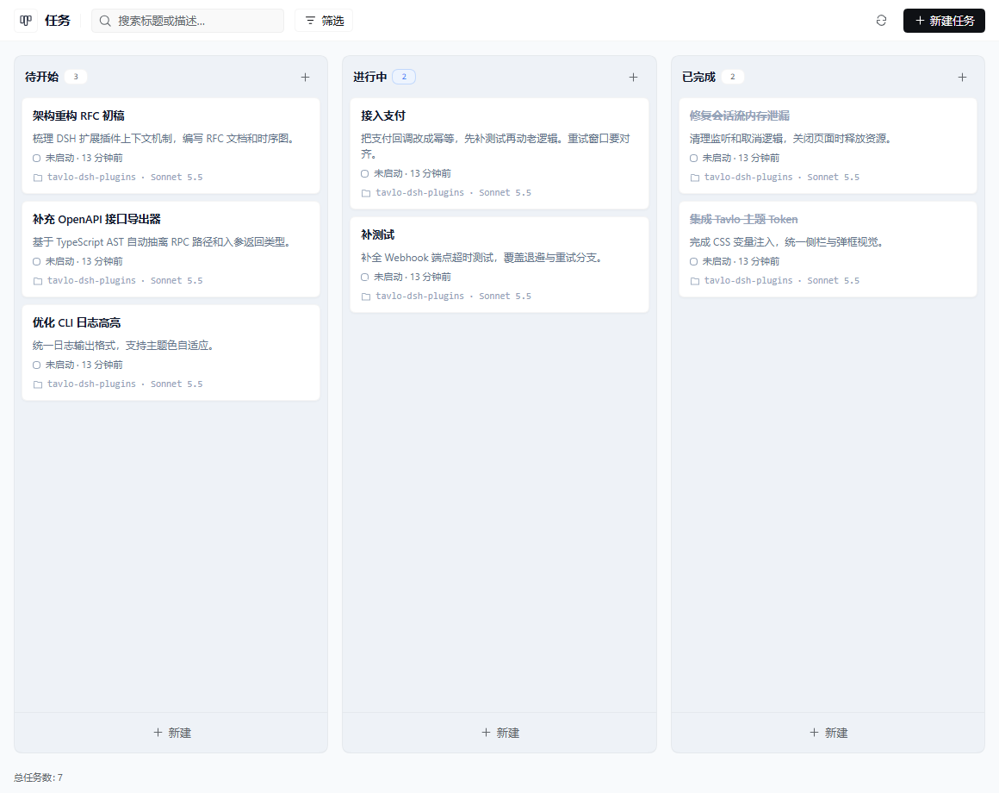
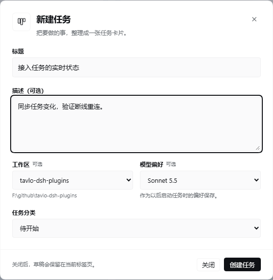

# 看板与新建弹框验证

2026-11-16，DSH 0.2.2-rc.1，现有 `web` profile 的本地 link 安装。保留零构建和原有 Connection RPC 路由。

## 当前界面

看板按 `prototype/code.v2.html` 调整为紧凑顶栏、灰蓝色列背景、白色卡片、两行描述和状态/工作区/模型摘要。右上菜单收起分类操作，标题打开完整详情；列底新建预选列分类，列标题可折叠。完成列默认显示最近更新的 10 条，显示总计数并可查看全部。工作区筛选仅作用于当前视图。

新建采用居中的原生 `dialog`，支持背景遮罩、焦点限制、Esc/背景点击/关闭按钮收起和入口焦点恢复。标题必填，描述、工作区、模型均可选；工作区默认未分组，模型默认不保存显式偏好。新建只持久化任务及偏好，不启动会话。

截图是隔离测试任务，未写入正式任务存储：

原型中的执行中、待审批、会话启动、告警条和子任务进度尚无真实数据来源，按后续会话关联及单任务启动阶段接入；本次不添加模拟状态或不可操作的按钮。任务实时同步已在 [步骤 4](step-4-verification.md) 完成。

## 数据与扩展点

`task-options.js:createTaskOptions()` 在请求时通过公开的 `ctx.get()` 读取 `workspaceRegistry.list()` 和 `sessionController.modelCatalog()`，返回名称与可选择的标识，不把凭据或提供方错误信息返回 Client。目录服务缺失或失败时可不绑定创建。新请求显式绑定必须存在于当前目录；工作区/模型失效不影响已有任务读取或原请求重放。

创建输入新增 `stage? / workspaceId? / model?`；`model` 为 `{ provider, model, reasoningEffort? }`。完整创建参数存入私有 `_create`，保证重试比较包含初始分类和偏好。Client 草稿也保存这些字段，结果未知时锁定原参数并重放。

domain 升级为 version 2，`compatibleVersions: [1]`。旧字段和新增可选字段由当前 schema 接受，旧 `_create` 没有 `stage` 时按原默认 `todo` 比较；不删除或复制旧任务。写入新版字段后旧插件不保证读取，不能据此承诺降级。

## 验证

`npm test`：40 项通过。继承 RPC、鉴权、持久化、取消和并发验证，新增工作区/模型目录降级、无效显式偏好拒绝、偏好持久化与重试、version 1 数据兼容、Client 选择/筛选/详情，以及完成列最近 10 条与展开/折叠后保留全部记录的测试。

真实页面通过 `dsh --profile web --patch <临时 storage.overlay.yml> --no-open --port 0` 启动，JSON root 指向隔离的临时目录。Playwright 控制独立无窗口 Edge，完成：

- 读取实际工作区和已配置的模型，表单保存真实 UUID 与提供方/模型标识；未选择时可创建。
- 用新建弹框创建七张测试卡片，三列正确分组，元信息显示 Host 目录里的工作区与模型名称。
- 卡片菜单改列后移动卡片并更新数量，标题打开含完整描述和工作区路径的详情。
- 弹框打开焦点进入标题，Tab 焦点留在弹框，Esc 后回到入口；收起与页面刷新保留标题、描述和工作区/模型草稿。
- 宽屏和窄屏检查；窄屏列横向滚动，弹框无横向溢出。深色主题使用宿主色板，已查看截图。
- 停止测试 Host 后用相同存储配置启动新进程，完整任务记录与重启前一致，工作区和模型偏好恢复。

页面没有 `pageerror`。验证浏览器和本次启动的 Host 已停止；正式 `C:/Users/1/.dsh/storages/tasks.json` 未写入。`npm pack --dry-run` 已确认包含新增 `task-options.js`、更新的 Client 和文档截图；没有新增运行时依赖或构建步骤。
